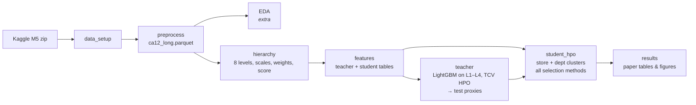

<h1 align="center">H-Pro on M5 — Hierarchical Proxy Modeling for HPO in Retail Forecasting</h1>

<p align="center">
  A faithful re-implementation of <b>Jati et al., "Hierarchical Proxy Modeling for Improved HPO in Time Series Forecasting" (ACM KDD 2023)</b><br>
  on a California subset of the Walmart <b>M5 Forecasting – Accuracy</b> dataset.
</p>

<p align="center">
  
  
  
  
  
</p>

---

## Table of Contents

1. [About the project](#about-the-project)
2. [The H-Pro idea in one minute](#the-h-pro-idea-in-one-minute)
3. [Dataset and subset](#dataset-and-subset)
4. [Hierarchy and metric](#hierarchy-and-metric)
5. [Pipeline](#pipeline)
6. [Repository / Drive structure](#repository--drive-structure)
7. [Notebooks](#notebooks)
8. [Results so far](#results-so-far)
9. [Paper fidelity](#paper-fidelity)
10. [How to run](#how-to-run)
11. [Roadmap](#roadmap)
12. [Team](#team)
13. [References](#references)

---

## About the project

Retail demand forecasting has to work at many levels at once: the whole company, each store, each department, and every single product in every store. Choosing hyperparameters (HPO) for the bottom-level model is hard, because product-level sales are **sparse and noisy**, so the usual "pick the trial with the lowest validation error" often picks badly.

The **H-Pro** paper proposes a fix: train a **teacher** model on the smoother, higher levels of the hierarchy, use its forecasts for the test period as **proxy targets**, and pick the bottom-level **student** model's hyperparameters by how well it matches those proxies (after aggregating up the hierarchy).

This project implements that method end to end on M5. The professor's requirement is a **faithful implementation of the paper**; EDA and any deployment work are extras.

## The H-Pro idea in one minute

```
            ┌──────────────────────────────┐
  Higher    │  TEACHER (LightGBM)          │  trained on total / store / category / department
  levels    │  tuned by time-series CV     │  → forecasts for the 28 test days = PROXIES
            └──────────────┬───────────────┘
                           │ proxy targets
            ┌──────────────▼───────────────┐
  Bottom    │  STUDENT (LightGBM)          │  many HPO trials, each forecasts every product-store
  level     │  per cluster (store / dept)  │  → aggregated bottom-up → scored against proxies
            └──────────────┬───────────────┘
                           │ pick the trial with the lowest proxy error
                           ▼
                 Final bottom-level forecast
```

| Selection method | How a trial is chosen |
|---|---|
| **TCV-Lowest** | Lowest validation error at the bottom level only |
| **TCV-Hier** | Lowest validation error averaged over the hierarchy |
| **H-Pro-Top** | Lowest error against the teacher's **level-1 (total)** proxy |
| **H-Pro-Avg** | Lowest error against the teacher's proxies for the **top levels**, equal weights |
| **-PO (per-offset)** | Best trial picked separately for each of the 28 forecast days, then concatenated |
| **Gold** | Best trial on the real test data (upper bound, reference only) |

## Dataset and subset

Source: [M5 Forecasting – Accuracy (Kaggle)](https://www.kaggle.com/competitions/m5-forecasting-accuracy/data) — daily unit sales of 3,049 Walmart products across 10 stores in CA, TX and WI, with calendar events, SNAP days and weekly prices.

The professor approved using a **subset**, provided the method stays faithful.

| | Paper (full M5) | This project |
|---|---|---|
| Stores | All 10 (3 states) | **CA_1 + CA_2** |
| Bottom series | 30,490 | **6,098** (3,049 items × 2 stores) |
| History | d_1 – d_1913 | **d_847 – d_1913** (last 3 years) |
| Test | d_1914 – d_1941 (28 days) | **d_1914 – d_1941** (same) |
| Rows in processed file | — | **6,096,944** (`ca12_long.parquet`, 17 columns) |

The five raw Kaggle files (sales, calendar, prices, etc.) are merged into one long table, one row per product-store per day, and saved once as `processed/ca12_long.parquet`. Every later notebook reads only that parquet.

## Hierarchy and metric

M5 defines 12 aggregation levels. With a single state, the state-based levels collapse onto other levels, leaving **8 unique levels**:

| Level | Meaning | Series | Role |
|---|---|---|---|
| L1 | Total | 1 | Teacher |
| L2 | Store | 2 | Teacher |
| L3 | Category | 3 | Teacher |
| L4 | Department | 7 | Teacher |
| L5 | Store × Category | 6 | Evaluation |
| L6 | Store × Department | 14 | Evaluation |
| L7 | Item | 3,049 | Evaluation |
| L8 | Item × Store (bottom) | 6,098 | Student |

**Metric:** the official M5 **WRMSSE** definition (RMSSE with naive one-step scaling, dollar-sales weights), averaged across levels, computed on the subset. Reconciliation is **bottom-up**.

## Pipeline



## Repository / Drive structure

Code runs in Google Colab from a shared Google Drive folder; this repo holds the notebooks and docs.

```
m5_project/
├── notebooks/
│   ├── data_setup.ipynb      # download M5 from Kaggle into raw/
│   ├── preprocess.ipynb      # CA_1 + CA_2, d_847–d_1941 → long parquet
│   ├── eda.ipynb             # exploratory analysis (extra)
│   ├── hierarchy.ipynb       # 8 levels, RMSSE scales, weights, score()
│   ├── features.ipynb        # teacher (L1–L4) and student (L8) feature tables
│   ├── teacher.ipynb         # teacher HPO and proxy forecasts
│   ├── student_hpo.ipynb     # (next) student HPO + all selection methods
│   └── results.ipynb         # (next) paper tables and figures
├── raw/                      # m5-forecasting-accuracy.zip (shared, downloaded once)
├── processed/
│   └── ca12_long.parquet     # cleaned subset — never modified after creation
├── outputs/
│   ├── teacher_proxies.parquet   # 13 teacher series × 28 test days
│   └── teacher_test_rmsse.csv    # teacher RMSSE per level (paper Table 5)
├── models/
└── reports/
```

## Notebooks

| # | Notebook | What it does | Paper link | Status |
|---|---|---|---|---|
| 1 | `data_setup` | Mounts Drive, authenticates with Kaggle, downloads the zip once | — | ✅ |
| 2 | `preprocess` | Filters to CA_1 + CA_2 and the 3-year window, merges calendar and prices, writes the parquet | Data subset | ✅ |
| 3 | `eda` | 13 questions on trend, stores, departments, seasonality, events, SNAP, intermittency, concentration, price | Extra (not graded) | ✅ |
| 4 | `hierarchy` | Builds the 8 levels, RMSSE scales, dollar weights and a single `score()` used everywhere | Sec 5, WRMSSE | ✅ |
| 5 | `features` | Lags 28–56, rolling means 7–56 (ending 28 days back), calendar, price (bottom only) | Our choice — paper is silent | ✅ |
| 6 | `teacher` | One LightGBM on all 13 series of L1–L4, random-search HPO by TCV, proxy forecasts for d_1914–1941 | Sec 4, 5.1.2–5.1.3, Table 5 | ✅ |
| 7 | `student_hpo` | Student trials on store and department clusters; TCV-Lowest, TCV-Hier, H-Pro-Top, H-Pro-Avg, -PO, Gold | Sec 4, Tables 4–6 | ⏳ |
| 8 | `results` | Level-wise table, Fig 1 analogue, ensembles (1)–(4) | Fig 1, Tables 4–6 | ⏳ |

Later notebooks load earlier ones with `%run` (e.g. `%run .../hierarchy.ipynb`) so every step uses the same data, levels and metric. Key notebooks end with an **assert lock** so a silent change in data or shapes stops the run.

### EDA highlights (d_847 – d_1913 only; test block excluded)

- 5,926,200 rows, **0 duplicate** (id, d) keys.
- Sales are extremely skewed: **median 0**, 90th percentile 4, mean 1.36, max 599 — the sparse, intermittent bottom level the paper describes. This motivates the Tweedie objective.
- Only ~8% of days carry a calendar event; prices range $0.01–$30.98 (median $3.48).
- EDA helper columns are kept in memory only and never written back to the parquet or used for modeling (see `claude/eda_column_log.md`).

### Features (non-recursive 28-day forecast)

| Group | Features |
|---|---|
| Lags | `lag_28`, `lag_35`, `lag_42`, `lag_49`, `lag_56` (same weekday, 4–8 weeks back) |
| Rolling means | 7, 14, 28, 56 days, all ending 28 days back |
| Calendar | weekday, month, events, SNAP |
| Price | sell price (bottom level only) |

Everything looks **at least 28 days back**, so no feature can see the answer during the 28-day forecast.

| Table | Shape | Series |
|---|---|---|
| Teacher (L1–L4) | 13,156 × 18 | 13 |
| Student (L8) | 5,706,588 × 24 | 6,098 |

## Results so far

**Baseline.** Copying the last 28 days forward scores **R_H = 0.827** on validation (locked by an assert in `hierarchy.ipynb`).

**Teacher (TCV random search, 30 trials).**

| | Validation mean | L1 | L2 | L3 | L4 |
|---|---|---|---|---|---|
| Default LightGBM | 0.356 | | | | |
| Best trial (#17) | **0.329** | 0.274 | 0.336 | 0.306 | 0.399 |

Best parameters: `learning_rate=0.1`, `num_leaves=15`, `min_child_samples=50`, `n_estimators=1000`, `colsample_bytree=1.0`, `tweedie_variance_power=1.3`.

**Teacher test RMSSE (paper Table 5 analogue):**

| L1 Total | L2 Store | L3 Category | L4 Department | Mean |
|---|---|---|---|---|
| 0.577 | 0.681 | 0.612 | 0.667 | **0.634** |

**Paper reference (full M5, WRMSSE):** Gold 0.512 · H-Pro-Top 0.512 · M5 winner 0.520 · TCV-Hier 0.534 · H-Pro-Avg 0.534.

Student results will be added after `student_hpo.ipynb`.

## Paper fidelity

The method follows the paper; only data size and compute were reduced. Full list in `claude/paper_fidelity_checklist.md`.

| Item | Paper | This project | Note |
|---|---|---|---|
| Data | Full M5 | CA_1 + CA_2, last 3 years | Approved subset |
| Hierarchy | 12 M5 levels | Same definitions, 8 unique | Duplicates removed |
| Metric | WRMSSE | Same formula on subset | Same |
| Teacher | One LightGBM on all teacher-level series, TCV HPO | One LightGBM on L1–L4 | Same |
| H-Pro-Avg levels | Total, state, store, category, department | Total, store, category, department | State = total |
| Student | Store- and dept-clustered LightGBM, ensembled | 2 store + 7 dept models, ensembled | Same |
| Per-cluster selection | Not fully specified | Each trial trained in every cluster, forecasts concatenated, selected on the full hierarchy (store set and dept set separately, then averaged) | Our reading; stated in report |
| Features, search space | Not listed | M5-winner-style features; lr, leaves, min_child_samples, n_estimators, colsample, Tweedie power | Our choice where paper is silent |
| HPO | Random search + Hyperopt, hundreds of trials, 3 seeds | Random search; teacher 30 trials, student ~10–15 trials, 1 seed (more if time) | Compute only |
| Reconciliation | Bottom-up | Bottom-up | Same |

## How to run

Everything runs in **Google Colab** against a shared Drive folder.

1. **Get the folder.** The owner shares `m5_project` on Drive. Teammates must right-click it → *Organize → Add shortcut to Drive → My Drive*, so `/content/drive/MyDrive/m5_project` exists for them too.
2. **Kaggle access (first time only).** Accept the competition rules on Kaggle, create an API key, and add it as a Colab secret named `KAGGLE_JSON`.
3. **Run the notebooks in order:**
   ```
   data_setup → preprocess → hierarchy → features → teacher → student_hpo → results
   ```
   `data_setup` and `preprocess` only need to run once; after that, every notebook just reads `processed/ca12_long.parquet`.
4. Each new Colab session needs `drive.mount('/content/drive')` first.

Main libraries: `pandas`, `numpy`, `pyarrow`, `lightgbm`, `matplotlib`, `seaborn`.

> **Rules we keep:** never modify the processed parquet; never use the EDA dataframe for modeling; the test block (d_1914–1941) is touched only for proxies, final scoring and the Gold reference.

## Roadmap

- [x] Data setup and CA subset
- [x] EDA (plain-language write-up in progress)
- [x] Hierarchy, scales, weights, `score()`
- [x] Feature tables for teacher and student
- [x] Teacher HPO and test proxies
- [ ] Student HPO: store + department clusters, all selection methods, -PO
- [ ] Ensembles (1)–(4) and level-wise results
- [ ] Fig 1 analogue (validation vs test error, proxy vs test error)
- [ ] Final report
- [ ] *(extra)* deployment

## Team

| Name | Role |
|---|---|
| Ankita | Project owner — pipeline, hierarchy, features, teacher |
| _Teammate_ | _role_ |
| _Teammate 2_ | EDA plain-language write-up |

CMPE 257 Machine Learning, San José State University · also an SJSU AI & ML Club project.

## References

- A. Jati et al., **"Hierarchical Proxy Modeling for Improved HPO in Time Series Forecasting,"** *KDD 2023*, ACM.
- S. Makridakis, E. Spiliotis, V. Assimakopoulos, **"M5 accuracy competition: Results, findings, and conclusions,"** *International Journal of Forecasting*, 2022.
- [M5 Forecasting – Accuracy, Kaggle](https://www.kaggle.com/competitions/m5-forecasting-accuracy)
- README layout inspired by [awesome-readme](https://github.com/matiassingers/awesome-readme) (style of *priyavrat-misra/xrays-and-gradcam*).
