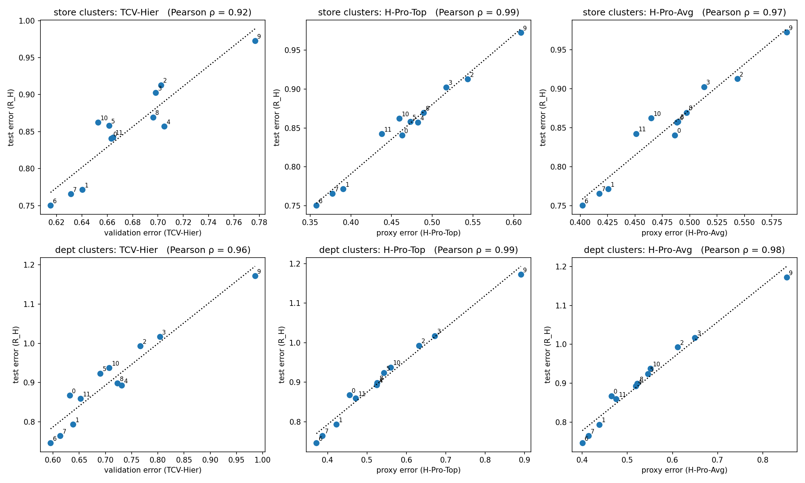

# H-Pro on M5: Smarter Hyperparameter Tuning for Retail Demand Forecasting

Reproduction of the KDD 2023 paper **H-Pro** (Jati et al., IBM Research) on Walmart M5 sales: 6,098 product-store series, forecast 28 days ahead, with the forecasts served in a live dashboard.

**[▶ Live demo](https://cmpe-257-machine-learning-3.onrender.com/)** · **[Code](https://github.com/Snehil-Raut/CMPE_257_Machine_learning)** · **[Paper](https://arxiv.org/abs/2211.15092)** · **[Slides](https://docs.google.com/presentation/d/1pDJgS02x8umiR-moaVaTei88aoj2hy6r4mYx-5S_xgg/edit?usp=sharing)**

<sub>⏳ The demo is on Render's free tier: the first load can take up to a minute while it wakes up.</sub>

- **Problem:** Models are usually tuned on last month's data, but product-level sales are sparse and next month often behaves differently, so the "best" settings can be wrong.
- **Approach:** A LightGBM *teacher* forecasts the smooth totals (store, category, department) for the test month. Those forecasts act as a proxy answer key to choose the settings of a LightGBM *student* that forecasts every product.
- **Result:** Proxy error tracked real test error at **ρ = 0.99** vs 0.92 for standard tuning, and H-Pro picked the best possible setting without seeing any test data.


**Stack:** Python · pandas · LightGBM · FastAPI · Chart.js · Google Colab · Render

---

## Results

Test error R_H on the 28-day test month (lower is better). All methods choose from the same 12 student settings.

| Method | Ours (2 stores) | Paper (10 stores) |
|---|---|---|
| Gold (oracle, sees test data) | 0.745 | 0.512 |
| **H-Pro-Top** | **0.745** | **0.512** |
| TCV-Hier (standard tuning) | 0.745 | 0.534 |
| H-Pro-Top, per day | 0.748 | 0.521 |
| TCV-Lowest, per day | 0.782 | — |



- **Reproduced:** H-Pro matched the oracle, and proxy error ranked settings far better than last month's error (ρ 0.99 vs 0.92; paper: 0.87 vs 0.47).
- **Difference:** with only 12 settings, standard tuning also found the winner, so the gap shows in ranking and in per-day choice (within 0.7% of Gold vs 5% worse). Absolute errors differ from the paper because the data is smaller.
- **Winning setting:** learning_rate 0.03 · 63 leaves · 400 trees · Tweedie loss (power 1.1).

Full level-wise tables: [`reports/`](reports/)

---

## How it works

```
 Smooth totals   TEACHER  one LightGBM on 13 aggregate series → forecasts the test month (proxies)
                     │
                     ▼  proxies
 Sparse products STUDENT  12 settings × (2 store + 7 department models) → product forecasts
                     │    summed up to totals
                     ▼
                 Keep the setting whose totals are closest to the teacher's proxies
```

| Method | Chooses the setting using |
|---|---|
| TCV-Lowest / TCV-Hier | Last month's real sales (standard approach) |
| **H-Pro-Top / H-Pro-Avg** | The teacher's proxies (total only / top 4 levels) |
| Gold | The real test sales (reference only) |

The proxies only choose the student's **hyperparameters**. The student itself is trained on real sales.

---

## Data and setup

| | Paper | This project |
|---|---|---|
| Stores | 10 (CA, TX, WI) | CA_1, CA_2 |
| Series | 30,490 | 6,098 (3,049 products × 2 stores) |
| History | ~5 years | 3 years |
| Test month | d_1914–d_1941 | same |

- **Features:** lags of 28–56 days, rolling means, calendar, SNAP days and price. Everything is at least 28 days old, so there is no leakage.
- **Metric:** official M5 RMSSE, dollar-weighted and averaged over 8 hierarchy levels. Checked: a perfect forecast scores 0, copying last month scores 0.827.
- **Differences from the paper:** 2 stores, 12 settings and 1 seed (paper: hundreds and 3), one validation month, our own features (the paper doesn't list them). The method itself is unchanged.

---

## Repository

```
├── notebooks/      data_setup → preprocess → EDA → hierarchy → features
│                   → teachers → student → results → app_export
├── reports/        result tables (CSV) and figures
└── backend/        FastAPI API + Chart.js dashboard, deployed on Render
```

## How to run

**Dashboard (local)**
```bash
cd backend
pip install -r requirements.txt
uvicorn app.main:app --reload    # open http://localhost:8000
```

**Experiments:** run the notebooks in order on Google Colab, with the data in Google Drive at `MyDrive/m5_project` and a Kaggle API key saved as the Colab secret `KAGGLE_JSON`. Raw data and models stay on Drive (too large for GitHub). Seed 0 reproduces the same 12 settings.

---

## Team

**Snehil Raut** · **Phani Divya Sree Tadinada**
CMPE 257 Machine Learning, San José State University, Fall 2026

## References

- A. Jati et al., "Hierarchical Proxy Modeling for Improved HPO in Time Series Forecasting," *KDD 2023*. [arXiv:2211.15092](https://arxiv.org/abs/2211.15092)
- [M5 Forecasting – Accuracy, Kaggle](https://www.kaggle.com/competitions/m5-forecasting-accuracy)
